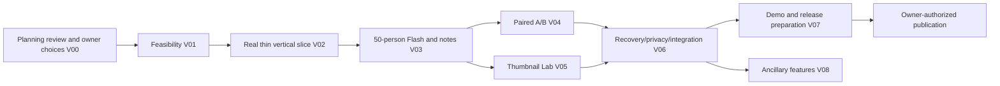

# Viralist delivery plan

Canonical local task: **VIR-PLAN — product discovery and technical strategy**. Status: author-complete planning package, owner corrections recorded 2026-10-28, independent review pending. Owner selected `ShrikarT/viralist`; origin is configured and the remote was verified public/empty. No canonical GitHub issue or push yet. Preserve IDs and link the planning commit when publishing the ledger to the selected GitHub Issues tracker; do not use the parent repository or duplicate task state.

## Gates and dependency graph

No product task is READY yet. Every task below is SPECIFIED-BLOCKED until its named prerequisites are accepted at immutable SHAs and the owner authorizes implementation. At dispatch, record exact `base_sha`, `prerequisite_shas`, reviewer/evidence links, checkout, branch, owned files and permitted spend in STATE/the canonical issue. A symbolic task ID or `main` is not an accepted prerequisite SHA. This deliberately avoids invented baseline hashes.

Critical path: V00 → V01 → V02 → V03 → V04 → V06 → V07. V05 joins before complete demo acceptance. Start with one implementation worker; V04/V05 can overlap only after a frozen contract and disjoint ownership receipt. No implementation worker is currently running.

## Definition of Ready and Done

READY requires authorized scope, accepted immutable baseline/prerequisite SHAs, frozen contract/fixture, bounded paths/non-goals, observable checks, permitted mock boundaries, external-action authority and stop conditions. Unresolved provider shape belongs in V01, not an implementation guess.

Author “implemented” advances only to WORKER-REPORTED. Independent exact-commit checks earn REVIEW-ACCEPTED; integration and combined-revision checks earn INTEGRATED; independent real-path checks on that artifact/environment earn JOURNEY-VERIFIED; owner-authorized deployment plus release checks earn RELEASED. No stage implies another. Two unsuccessful review-correction rounds trigger recorded reassessment. Re-verification is required after code changes.

## V00 — accept decisions and establish dispatch baseline

- Behavior: a future worker knows what is authorized, which repository it owns and what evidence is required.
- Preconditions: planning commit exists; owner reviews PROJECT_BRIEF. Accepted baseline: none yet.
- Interface/ownership: planning docs and contract proposal only; owner/integrator owns STATE/PLAN. No product code.
- Check: approve/amend upload/latency contract, record exact planning SHA and reviewer findings; settle license, replacement owned demo footage, Standard API behavior and hard spend cap. Remote selection and receipt of $150 credits are owner-confirmed; Muse Image playground works, but API/policy discrepancy remains. No need to settle paid-product pricing.
- Real versus simulated: read actual account access/billing only when authorized; no invented credit receipt. Public event facts are not proof of selection.
- Risk/review: low implementation complexity, high dependency significance; one document review. Not parallel-safe with changes to core contracts.
- Blockers: owner decisions and independent review availability. Stop after a concrete decision record; do not publish or test paid providers just because the plan exists.

## V01 — bounded integration and fidelity experiments

- Owner continuation: explicitly authorized fixing the observed issues and staged Spark 1.3 reruns under the original cumulative $10 ceiling. Current source/results and live-handle recovery are recorded in STATE; the earlier blanket experiment blocker is superseded for this bounded work. Product task acceptance and deployment remain separate.
- Latest result: requested correction/rerun **WORKER-REPORTED complete** at provider source `04b852728ae22967f408f71e34f274911ab07578`; both small casts and the final 50-person stage passed. Complete local report took 88.192025s including media preparation; final run ~$0.94, so the earlier proposed $0.50 product-cost target still fails. See [full evidence](docs/evidence/spark13-rerun.md). Independent acceptance and production journeys remain pending.
- Historical baseline: [initial provider results](docs/evidence/provider-spike.md) took 177.688s for the 50-person loop and exposed audio/thumbnail issues. It is superseded by the latest corrections, not erased. Matched A/B, 60s worst-case footage, independent review and production integration remain pending.
- Behavior: establish whether the planned 50-person loop is feasible and what the actual adapter accepts.
- Preconditions for implementation acceptance: accepted V00 SHA remains pending. The owner separately authorized this experiment with two local videos, private credentials and a $10 ceiling; those inputs and access are settled.
- Interface: C2/C3/provider boundary in CONTRACTS; produce redacted real request/response fixtures, timestamp/cost tables and pass/fail conclusions. These are integration discoveries, not production journey proof.
- Ownership: `experiments/`, `docs/evidence/provider-spike.md`, proposed contract amendments through the integrator. No production UI or automatic SDK upgrades.
- Experiments (time budgets bound discovery; they do not delete product scope):

| Spike | Question/test | Pass/fail and next action | Budget |
|---|---|---|---|
| S0 | Catalog, Standard mode, one 3s owned clip, credit balance and deletion | Authorized model accepts documented request and usage is observable; otherwise record exact sanitized status and block dependent coding | 30min; within owner-authorized $10 experiment total |
| S1 | Can features preserve time and isolation? Two scene markers, known text/audio, silent control, current-only clips/frames | All required cues recovered at declared granularity; no future cue appears in early input; compare frames/native quality honestly. Resolve SDK format from docs if rejected | 45min; stop after two schema attempts |
| S2 | Can 50 personas finish affordably? Batch ≤5 active IDs/scene; actual 60s footage; include worst-case no early skips | ≥40 valid responses with visible partial handling; full 50 for normal completion, verdict ≤90s and cost ≤proposed $0.50/run. If fails, measure bottleneck and revise contract with owner, never secretly shrink cast | 90min; ≤3 runs inside total cap |
| S3 | Are notes useful and stable? Same owned A/B cuts, blinded labels, one deliberate change; swap A/B order | Supported changed-timestamp note survives order swap; unrelated notes not falsely resolved. No requirement that B always scores higher | 45min; ≤2 comparisons if cap permits |
| S4 | Can deletion truthfully complete? Enumerate and delete all uploaded provider IDs | API confirms removal and new retrieval fails; verify UI claim only covers what was checked. Outage/policy retention remains explicit | 30min; reuse prior uploads |
| S5 optional | Does one Wonder note call add value over Spark? Same evidence, blind scoring of specificity/support/faithfulness | Keep only if all three criteria are no worse and ≥1 better, with one quoted note per model and measured cost inside cap | 20min; one call/model, only after core proof |

- Mock permissions: canned malformed/429 examples for parser development; S0/S1/S2/S4 require actual provider calls. S3 is a mechanism check, not user-demand/virality validation.
- Risk/review: high, 0.5–1 day including evidence review; not parallel-safe with contract freeze. Stop at cap, geographic restriction, ambiguous charged request or two unsuccessful correction rounds. Owner decides material redesign; preserve all evidence.

## V01-DIV — measure behavioral differentiation before enlarging the library

- Owner follow-up: strengthen and actually test fifty candidates without expanding process. **$15 cumulative cap explicitly approved**, preserving all prior spend/reserve. Active bounded follow-up uses `build_fifty.py`, fifty fixed cards, a repeated blinded text battery with alias controls, and a separate fifty-viewer supplied-video scheduler run. Current state and private artifact root are in STATE. No fifty-distinct claim until actual decisions separate.

- Owner authorized starting the proposed six-policy benchmark; the original cumulative $10 provider cap still applies. This authorizes a local experiment, not product implementation or publication.
- Frozen experiment source: `3fa326c4a20f9dbc23c77e4152a2a012cdc852db`. Owned paths: `experiments/behavior/`, the optional custom-card scheduler seam, regression tests and evidence/context documents. No changes to the original 50-instance baseline.
- Interface: [fixed policies](experiments/behavior/policies.json), [preregistered protocol](experiments/behavior/PROTOCOL.md), inference-safe fixtures and separate analysis-only expectations. Six candidates, a baseline and its identical-card alias; 30 controlled clips; 608 requested viewer trials.
- Acceptance: repeat blinded judgments, preserve skip isolation and cost chain, test unchanged policies on unseen tasks, include negative/missing results and all diagnostic comparisons. Distinct names or attribute combinations cannot earn distinct-policy counts. No forced disagreement or claim of human calibration.
- Result: **WORKER-REPORTED complete**; 608 valid viewer trials / 1,206 scene decisions, zero failed personas. Only privacy reproduced its preregistered contrast in both phases; five policies remain unproven. Identical-card stable disagreement on 4/30 clips prevents treating row labels as independent behaviors. [Results and complete matrix](docs/evidence/persona-diversity-results.md). Frozen baseline remains unchanged.
- Cost: this benchmark $4.53230625 estimated; cumulative $7.72663950 plus retained $1.31327 unknown reserve, tracked maximum $9.03990950 under the original $10. All processes terminal; no charged retries or uploads. One constant disclosure-encoding discrepancy is recorded without rewriting evidence.
- Independent exact-revision review unavailable (Orca unavailable); retain WORKER-REPORTED until independently accepted. No publication, deployment or new tracker write. Product implementation and further experimental redesign remain separate work.

## V02 — one complete thin user journey

- Behavior: owned upload → durable analysis → a small visibly labeled test cast → one supported note → delete; refresh survives processing.
- Preconditions: accepted V00/V01 SHAs; adapter response fixture resolved. This is a test-profile slice, not a completed Flash product.
- Interface: C1–C5/C8 and synthetic fixture; executable schema mirrors frozen proposal and real V01 adapter mapping.
- Ownership: initial manifests/lockfiles, `apps/`, `contracts/`, `migrations/`, `tests/` scaffold. One writer because this crosses modules; freeze generated interface ownership before subsequent tasks.
- Acceptance: clean environment installs using committed manifests; server rejects invalid media before model dispatch; real owned clip runs through production worker/adapter to evidence-linked note; reload preserves run; another session cannot read it; delete revokes it and removes controlled objects. Record exact commands in README only after running them.
- Mocks: external model/storage boundary may be emulated for error tests; acceptance also requires a real adapter smoke. Never mock production scheduler, session checks or event persistence to prove them.
- Non-goals/invariants: no elaborate graph, payments, calibrated scores or public share. Source/code-in-window evidence starts here, distinct from planning documents.
- Risk/review: high, roughly 1–2 focused days; reviewer checks transactional recovery and actual path. Blocked by V01/access/runtime selection; no parallel implementation.
- Stop: satisfy thin-slice tests at frozen SHA or report exact failure; two failed corrections require redesign.

## V03 — Flash, transparent report and live evidence view

- Behavior: 50-person Reels run streams real reactions and yields up to three actionable notes, ranges and assumptions.
- Preconditions: accepted V02 SHA; C2–C5 frozen; S2 cost/latency decision accepted.
- Ownership: simulation/reporting modules, run-view UI, archetype/trend data, corresponding tests. Integrator alone changes DB/contracts. Use shadcn defaults when selecting primitives and browse for actual UI path.
- Interface: trace → resample/scenario → metric/note/evidence → UI; C5 and fixture arithmetic. Implement documented subscore/method definitions, not new unexplained scoring formulas.
- Acceptance: A01/A02/A03/A07 in ACCEPTANCE; first 3s boundary, 50 actual cast instances, no future leakage, traceable notes and intervals, degraded cast clearly shown, keyboard/text alternatives and reduced motion. Repeated runs record different LLM outputs without promising determinism.
- Mock permissions: external responses for deterministic replay/regression; real 50-person run needed for performance/provider claim. A fixture screenshot cannot prove a live graph.
- Non-goals: Deep, real-world accuracy, brand superiority, calibration/fidelity numbers, additional niches. Thin grounding library warns rather than fabricates evidence.
- Risk/review: high, 1–2 days; one author plus independent verifier; no parallel work inside shared report contracts.
- Blockers/stops: latency/cost gate, supported notes, expired authorization; complete frozen test report or stop at two correction rounds.

## V04 — compare the edited cut and retain session history

- Behavior: user uploads B, sees compatible paired deltas/retention and checks whether a note's measured condition changed.
- Preconditions: accepted V03 SHA with stable C6; same-cast creation path.
- Ownership: `apps/api/app/reporting/compare*`, `apps/web/src/features/compare/`, compare/history tests. Integrator owns routes/navigation/shared schema.
- Interface: C6 base/revised manifests and paired indices; no independent-interval subtraction. Detector identity plus matching feature/timestamp mapping proposes resolution; user confirms uncertain mapping.
- Acceptance: A04 plus session ownership checks; same input negative control does not force a winner; mismatched model/config gives visible incompatibility; B is never predetermined to win; history persists within session retention.
- Mock permissions: model boundary for paired arithmetic; owned A/B must run for real to claim the demo loop.
- Non-goals: edit rendering, publishing, cross-account sharing, automatic accuracy claims.
- Risk/review: medium/high, 0.5–1 day; could parallel V05 only with frozen interface and disjoint integration ownership. Stop if alignment cannot support a note match; render uncertain instead.

## V05 — Thumbnail Lab with a permitted source

- Behavior: compare original + three thumbnail variants using a 30-person simulated panel; export chosen PNG. Intended generator is Muse Image where permitted; owned-frame/layout variants are fallback.
- Preconditions: accepted V03 SHA and C7 freeze; source-frame rights confirmed; Muse Image API access and applicable permission resolved before live generation. Playground access is owner-confirmed, not an app integration test.
- Ownership: `apps/api/app/thumbnails/`, `apps/web/src/features/thumbnails/`, thumbnail tests. Integrator owns route/schema changes; no overlap with V04 shared UI.
- Interface: C7 source provenance, actual vote counts/reasons and tie handling. Pair same panel across variants, randomize order and record it.
- Acceptance: A05; each variant records source/provider provenance. Muse Image claims require permitted actual API calls with receipts; fallback layouts are labeled. Real vote inference and distinct denominator per variant; missing/tied votes never become a guaranteed CTR improvement; exports are deletable derivatives.
- Mock permissions: external voting response for error/tie tests; live panel for integration claim. Local frame layouts are not generative-model output.
- Non-goals: alternative paid image provider selection and predicted click-through-rate calibration. Any image-generation sponsor claim must match verified use; playground access alone is insufficient evidence.
- Risk/review: medium, 0.5–1 day; optional SAM crop only if its real geometry improves an inspected output. Stop on unavailable legal input or budget; preserve lab scope as blocked rather than fabricate.

## V06 — verify failure recovery, deletion and combined journey

- Behavior: interrupted runs recover without double counting; private media remains private and deletable; combined A/B/lab works.
- Preconditions: accepted V04/V05 SHAs; integration owner combines work then freezes a new SHA. V03 acceptance does not automatically cover this revision.
- Ownership: integrator fixes shared code/migrations; independent verifier owns evidence under `docs/evidence/`. No simultaneous production writers during frozen verification.
- Interface: C1–C8; full job/event/provider artifact inventory; deletion fences and cost reservations.
- Acceptance: all applicable A01–A09 on production components; kill worker, reconnect SSE, duplicate POST, ambiguous provider timeout, no-speech, invalid media, session crossover, delete in flight, provider outage, budget exhaustion, restored backup respects tombstones. Record exact SHA, commands, environment, mock boundaries and gaps.
- Mocks: inject external rejection/outage only; use real DB/worker/renderer/storage implementation. Separate live provider deletion smoke and full owned-media browser path.
- Non-goals: enterprise certification or load beyond declared demo capacity. Anonymous public intake stays closed without quotas/abuse controls.
- Risk/review: high, ~1 day; single integrator and read-only verifier. No journey acceptance if Orca/another independent verifier unavailable; retain WORKER-REPORTED.
- Stop: two failed corrections require revised design; never patch evidence to pass.

## V07 — rehearsal and release preparation

- Behavior: a judge can follow a truthful three-minute demo and reproduce the documented build.
- Preconditions: journey-verified V06 integration SHA, owned assets, confirmed event rules and license. Source/deployment identity pinned.
- Ownership: README reproducibility, `docs/LAUNCH_STORY.md`, asset/provenance/evidence manifests, submission draft. No product changes during capture without re-verification.
- Interface: exact accepted build → real capture → optional creative pipeline → draft submission. LAUNCH_STORY defines shots and disclosures.
- Acceptance: three complete rehearsals; report observed latency/cost and failure fallback; live and recorded labels unmistakable; links accessible only after authorized publication; public repository/source license and new-work inventory checked; three-minute export inspected for captions/audio/readability.
- Real/mocked: live segment uses actual app; outage backup is visibly a recorded replay. No simulated UI footage as working integration proof.
- Risk/review: medium, ~0.5–1 day; release claims reviewed independently. Human approvals: hosting/spend, public repo, asset rights, submission, posting and release. No autonomous merges.
- Stop: prepare concrete artifacts then wait for owner release authority. Event deadline is Nov 5 07:30 IST; use Nov 3 for question resolution as reported by supplied guide, not verified official office hours.

## V08 — ancillary product behavior after core acceptance

- Behavior: hook-only partial what-if, PDF export and explicit expiring sharing improve iteration/distribution without implying an actual edited-video run.
- Preconditions: accepted V06 SHA; owner prioritization; privacy/share contracts frozen by this task before feature coding.
- Ownership: bounded new `whatif/`, `exports/`, `sharing/` modules and corresponding UI/tests; DB/routes serialized by integrator. Split into separate issues if ownership ceases to be bounded.
- Interface: hypothesis + stored feature bundle → separately labeled result; PDF carries provenance/watermark; share capability is opt-in, revocable, expiring and excluded from default uploads.
- Acceptance: modified-feature run cannot be mistaken for real B; original manifest immutable; PDF accessible/readable; revoked/expired links denied; deletion removes copies and invalidates shares. Real rendering and authorization required; provider boundary may be mocked for arithmetic only.
- Non-goals: new media render, public indexing, paywall, anonymous unrestricted share; risk medium/high, 1–2 days after scope split. Not parallel-safe with privacy migrations. Stop if share revocation/deletion cannot be demonstrated.

## Milestones and retained roadmap

M0: V00/V01 resolve feasibility; M1: V02 proves a thin real path; M2: V03–V05 prove the demo loop; M3: V06 independently checks the combined artifact; M4: V07 prepares/authorizes release. Estimates are risk indicators, not a promise to finish every item before the event. If the critical path fails, present actual status and an honestly labeled replay; do not silently cut scope or fake completion.

Retained roadmap epics (NOT READY tasks): Deep 300–500/native hybrid/full notes/unwatermarked reports → multi-platform → lawful niche benchmarks → accounts/credits/custom audience/API/sharing expansion → opt-in posted actuals/public accuracy dashboard. Larger archetype library, automated trend ingestion, richer what-if and 500-node graph performance enter those epics. Each requires its own contract and acceptance before dispatch. Calibration requires actual data and an explicit change to the current no-accuracy mandate.
