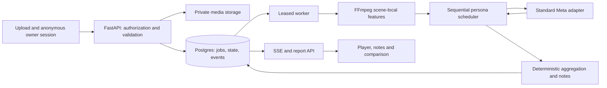

# Architecture proposal

**Recommend a modular monolith with a separate durable media worker.** React/TypeScript web UI; Python/FastAPI API and worker sharing domain modules; PostgreSQL for ownership, run state, jobs/events and manifests; private object storage for media/derivatives; FFmpeg for probe/cut/audio measurements; Standard Meta adapters behind explicit capability contracts. Exact package versions and hosting are unselected. No stack is installed in this repo.

Why: video decoding and multi-step inference must survive browser disconnects and process restarts. Keep one domain/data model; avoid a broker and microservice fleet at this scale. FastAPI request background tasks alone are not the durability mechanism. Postgres queue semantics are documented, but the task plan must prove our lease/recovery implementation. [References](RESEARCH.md)

Rejected: all processing in serverless request handlers (media lifetime/timeouts and resumability); browser-only provider calls (secrets and media control); a service per pipeline stage (operational and contract overhead). Next.js plus a worker is viable, but adds no needed server-rendering advantage for this authenticated workbench. Choose one UI stack at scaffold and pin compatible supported runtimes rather than assuming installed Node 26/Python 3.10 are the deployment versions.

## Proposed module ownership

| Boundary | Paths reserved for later implementation | Owner role |
|---|---|---|
| Wire contracts/generated client | `contracts/`, `apps/api/app/contracts/`, `apps/web/src/generated/` | Integrator; one authority, generated consumers |
| HTTP/session/storage | `apps/api/app/http/`, `apps/api/app/storage/` | API implementer |
| Decode/features | `apps/api/app/media/` | Media implementer |
| Persona scheduling/provider calls | `apps/api/app/simulation/`, `apps/api/app/providers/` | Simulation implementer |
| Scenario/notes/compare | `apps/api/app/reporting/` | Reporting implementer |
| Worker/job persistence | `apps/api/app/jobs/`, `apps/api/app/db/`, `migrations/` | Integrator owns transactional changes |
| UI | `apps/web/src/` except generated code | UI implementer |
| Test evidence | `tests/`, `docs/evidence/` | Verifier checks; author supplies fixtures |

These directories do not yet exist. [Contract proposals](CONTRACTS.md) and their single [fixture](contracts/vertical-slice.v1.json) are the producer/consumer baseline to freeze before parallel work.

## Data and invariants

Persist `OwnerSession` (hashed opaque capability, expiry), `Video` (owner, media hash, duration, private object references, deletion state), immutable `FeatureBundle`, `Run` (manifest, lifecycle, cast/seed, source revision, caveats), `PersonaCheckpoint`, `ReactionEvent`, `JobLease`, `ProviderCall`, `Report` and `DeletionJob`. Archetype and static trend-pack snapshots are versioned content; notes/scenarios can live in versioned report JSON initially. Thumbnail variants/votes belong to a run and share its ownership/deletion rules. Do not create future billing/actuals tables now.

Database is authoritative for progress; object storage is authoritative for bytes. SSE is delivery, not state. Immutable feature bundles include extraction version, timebase, per-scene data and provenance; a persona receives only a scene-local projection. A late scene's transcript or a full-video semantic summary cannot reach an earlier persona decision, including through prompt caches, retrieved context or a multi-persona batch.

Lifecycle: `uploaded → analyzing → ready → simulating → propagating → reporting → complete`; `failed` stores stage and retryability. Optional stage caveats do not erase failures. Terminal delete state outranks every stage. Cancel/deletion invalidates leases and prevents late writes resurrecting content.

Use unique `(run_id, persona_id, scene_id)` accepted verdicts and monotonic event sequences. Commit accepted verdict, updated checkpoint and emitted event in one transaction. Claim jobs transactionally with expiring leases; record dispatch before network I/O and response before advancing. Never keep a DB lock across inference. Lease loss requires fencing on writes.

Provider requests are not assumed exactly-once. On explicit retryable rejection use bounded backoff/Retry-After; on ambiguous timeout reconcile stored request ID/status if supported, otherwise mark uncertain and pause that unit. Do not blindly issue a second potentially charged generation. At most two attempts for known retryable rejection; schema repair at most once within reserved budget. Invalid/missing persona blocks do not become invented reactions.

## Media and model path

Probe bytes, enforce 60s/200MB bounds and decoder limits, extract cuts and ≤5s viewing segments with an explicit first 0–3s segment. This ensures a decision at the hook boundary even for a continuous take. Preserve original millisecond timebase and measured boundary precision. Frame-only Flash uses current-segment sampled images, transcript and telemetry; native per-segment clips are the fidelity spike/Deep path, with no claim that frame sampling captured all motion.

Store clip-local OCR, transcript granularity, motion and RMS observations. Audio-free inputs continue with caveats. SAM is object-mask enrichment, not the scene clock. A meaningful proposed SAM consumer is a visible-product crop for a thumbnail; if that consumer is absent, do not call it merely for sponsor credit.

Static archetype cards distinguish cited behavior from invented mood/attention priors. No asserted fidelity score or representative population. Default cast is 50 instances; batch at most five active personas per scene in the first experiment. Future scenes wait for the current verdict; skipped and failed personas are not forwarded. Fewer than 40 valid personas yields a visibly incomplete report, no full-cast completion claim; all failures produce a failed run, not empty “success.” This threshold is a proposal, not a statistical guarantee.

Notes use deterministic triggers plus model wording constrained to stored evidence IDs. Proposed v1 detectors: segment stop fraction ≥15% of personas entering that segment; confusion flagged by ≥20% of valid segment respondents; measured silence ≥1.5s between 10% and 80% of video duration; or first detected CTA after 80% of duration. Each requires a cited observation and a supported concrete fix; a trigger alone does not prove causality. Rank by observed affected-persona fraction, with timestamp as stable tie-breaker; label ranking heuristic, never predicted recovery or reach uplift. Validate every quoted reason and time range; unsupported prose is rejected. Abuse/deception flag withholds optimization advice while allowing neutral findings. Model-generated user strings are escaped.

## Simulation methodology proposal

Cast randomness is seeded; provider text is not promised deterministic. Store validated responses and versions for replay. Resample complete persona traces (not individual scenes) 200 times, with replacement, using a separately recorded seed; show nearest-rank p10–p90 as **simulation resampling range**, not calibrated confidence. This models internal panel variability only; it omits model bias, real audience mismatch and platform uncertainty.

Derived subscore proposals: Hook = survival at 3s; Pacing = survival to 80% of duration; Clarity = fraction without an explicit confusion flag; CTA = fraction recognizing the CTA among personas reaching it. All are 0–100 heuristic indices with resampled ranges and denominators. Trend fit is rule-match coverage against a dated static pack; unavailable if no grounded rules apply. Do not interpret pacing/clarity scores as causal measurements. Freeze these definitions and any revised weights in the manifest before A/B.

Reels propagation is a separate hypothetical scenario. Proposed v1 constants: seed audience 50, at most three cohorts, 2× cohort expansion, gate ≥0.6 for `0.45*completion + 0.25*share + 0.15*save + 0.10*like + 0.05*comment` rates, 48-hour exponential decay and 168 hourly steps. Expose every parameter and mark them uncalibrated assumptions. Subsequent cohorts reuse/resample observed traces; they are **not additional LLM viewers**. This is a proposed correction to the brief's fresh-persona expansion, keeping the Flash cast/cost bounded; Deep can add genuine new viewers later.

Apply the same scenario function to each resampled trace set; report ranges and optional sensitivity to a second explicitly named parameter set separately. Reach is hypothetical, not extrapolation validated against Instagram. A/B uses paired persona indices, same cast/settings and propagation assumptions; a delta range crossing zero has no declared winner. One model/pack change makes a comparison non-comparable unless rerun under matching settings.

## Privacy, abuse and operations

- Anonymous session cookie is HttpOnly/Secure/SameSite, server hashed, finite expiry. Authorize every asset/run/event/compare/delete endpoint; random IDs alone are not authorization. Apply origin/CSRF protection and quotas before enqueue.
- Private storage with short-lived retrieval grants; no public upload URLs. Initial deployment uses API upload streaming to private storage, not in-memory buffering. Do not accept arbitrary remote media URLs. Reject spoofed MIME, path traversal and dangerous decoder inputs; bound CPU/RAM/time and disable decoder network protocols.
- Request no model tools. Treat transcript/OCR/instructions inside clips as data. Server credentials from environment/secret store, with separate dev/demo keys. Standard mode is mandatory for private footage. Provider processing/retention disclosure must be accurate; no blanket “nothing retained” claim.
- Proposed anonymous retention is 24 hours, with owner-visible countdown and janitor. Provider uploads request 24-hour expiry when supported. Delete all controlled artifacts on request; revoke access immediately; target controlled-store deletion ≤60s. Upstream unavailable → pending deletion with retry and alert, not a false success toast. Downloaded copies on a user's device cannot be recalled; disclose that limitation for exports/sharing. No content in analytics; retain only non-reconstructive operational tombstones.
- Telemetry: run/stage/request IDs, duration, status, actual input/output tokens/frame/audio usage, evidence hashes and sanitized errors. Restricted content evidence is itself deletable. No raw video, transcript, signed URL or secret in logs.
- Reserve estimated maximum spend atomically before a job. Proposed smoke allowance $5, Flash ceiling $0.50/run and total ledger ceiling no higher than verified credits minus owner-set reserve; these are gate proposals, not authorized spend. A 15%-remaining daily alert is advisory, never the enforcement mechanism. Unknown balance/model price fails closed.
- Illustrative budgeting only: 100k input + 20k output Spark tokens would be $0.21 at cited rates, before media/other calls. Fifty personas × twelve segments can dominate latency and output volume. Measure first; never promise near-zero cost.
- Local/dev, owned-media staging and public-demo environments have separate data/secrets. Proposed deployment is one container image with API/worker entrypoints, managed PostgreSQL and private object storage; provider/vendor selection and any spend are owner-gated.
- Version schema migrations; test migrate/restore on disposable data, use additive changes initially. Deploy digest/source SHA must match verified evidence. Roll back to prior image; pause incompatible workers, preserve DB and revoke new intake. Backup retention must respect deletion commitments; prove tombstones apply after restore before accepting private users.

No deployment, backup, security control or rollback has been exercised. The proposal deliberately carries these as acceptance work rather than implied guarantees.
